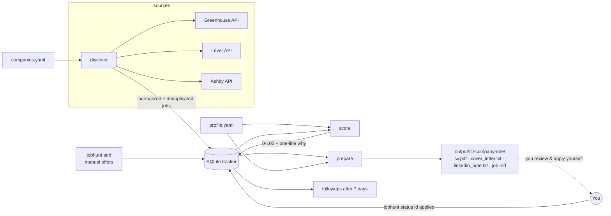

# job-hunt-copilot

[](https://github.com/carloslopezparga/job-hunt-copilot/actions/workflows/tests.yml)


A **human-in-the-loop** internship search assistant for an industrial engineering student
(ETSII-UPM) looking for remote internships now and summer/off-cycle 2027 internships in
**AI/tech, quant/trading, investment banking, consulting and fintech**, preferably outside
Spain. Applications are prepared in **English** (default) and **Spanish**.

It finds postings on public job boards, scores them against your profile, and prepares a
tailored **CV (PDF)**, a **150–200 word cover letter** and a **LinkedIn note (≤ 300 chars)**
for each good match. It also tracks your pipeline and reminds you to follow up after 7 days.

> [!IMPORTANT]
> **The copilot never applies for you.** It does not submit forms, send emails or messages,
> or automate LinkedIn in any way (no scraping, no clicks, no bots). It only reads
> **public, documented job-board APIs** and writes files to your disk. **You** review every
> document, decide whether to apply, and send it yourself.
>
> **It never invents or embellishes anything about you.** Every sentence in your CV, letters
> and messages is assembled from facts you wrote in `profile.yaml`. If your profile is too
> thin for a 150-word letter, you get a warning, not filler. An optional LLM can rephrase
> text, but a fact guard throws away any output that adds numbers, names or links.

---

## How it works



| Module | What it does |
| --- | --- |
| `profile.yaml` | Your single source of truth: education, experience, projects, languages (real CEFR level + certificate only if you hold it), skills, sector motivations, and role/sector/location/date preferences. Git-ignored. |
| `src/jobhunt/sources/` | Connectors for the public **Greenhouse**, **Lever** and **Ashby** job-board APIs behind one `JobSource` interface, normalizing postings into a common `Job` model. A failing board never stops the run. |
| `src/jobhunt/scoring.py` | Scores each job 0–100 (role, sector, contract type, remote, dates, skills, location) with configurable weights, a one-line explanation, and duplicate filtering. |
| `src/jobhunt/generator/` | Tailors your profile to the job (ranks *your* bullets/projects/skills), renders Jinja2 templates (EN/ES) and a reportlab PDF CV. Optional LLM polishing behind an interface; works fully without one. |
| `src/jobhunt/tracker.py` | SQLite pipeline: `new → prepared → applied → follow_up → interview / rejected`, full history, 7-day follow-up reminders, CSV export. |
| `src/jobhunt/cli.py` | Typer CLI: `init`, `discover`, `add`, `score`, `prepare`, `status`, `followups`, `export`. |

## Installation

Requires **Python 3.12+**.

```bash
git clone https://github.com/carloslopezparga/job-hunt-copilot.git
cd job-hunt-copilot
python3.12 -m venv .venv && source .venv/bin/activate
pip install -e ".[dev]"          # add ,llm for optional LLM polishing: ".[dev,llm]"
```

## Try it offline in 30 seconds

The repo ships realistic API fixtures for three **fictional** companies and a **fictional**
example profile, so you can see the whole pipeline without network access or personal data:

```bash
export JOBHUNT_PROFILE=profile.example.yaml
export JOBHUNT_COMPANIES=tests/fixtures/companies.sample.yaml
export JOBHUNT_TODAY=2026-10-07          # pin "today" so the fixtures' dates make sense

jobhunt discover --fixtures tests/fixtures
jobhunt score
jobhunt prepare --top 3
open output/                              # or xdg-open / explorer
```

## Usage

### 1. Create your profile

```bash
jobhunt init            # copies profile.template.yaml -> profile.yaml (git-ignored)
```

Fill in every field marked `TODO`. The template explains each one. A few rules:

- **Write only what is true** and you can defend in an interview. Numbers only if you measured them.
- **Languages**: `level` is your real CEFR level; `certificate` only if you actually hold it
  (e.g. `Cambridge C1 Advanced (2022)`). Leave it empty otherwise.
- **Bilingual text**: any free-text field can be `"text"` or `{en: "...", es: "..."}`. Spanish
  letters never mix languages: untranslated sentences are left out (and reported).
- `jobhunt prepare` **refuses to run while any `TODO` remains**, so a half-filled template
  can never end up in front of a recruiter.

### 2. Discover offers

```bash
jobhunt discover                       # all boards in companies.yaml
jobhunt discover -c Stripe -c Monzo    # just a few
```

`companies.yaml` lists ~30 AI, fintech, quant and consulting employers with their ATS
(`greenhouse` / `lever` / `ashby`), board slug and sector. Add or remove freely.

Investment banks and MBB consultancies mostly recruit through Workday/Oracle/in-house
portals with no public API. Track those offers manually (paste the description into a file):

```bash
jobhunt add --company "Example Bank" --title "Summer Analyst 2027 - IBD" \
  --url "https://careers.example.com/123" --sector investment_banking \
  --location "London, United Kingdom" --workplace onsite --description-file desc.txt
```

### 3. Score

```bash
jobhunt score                  # scores new jobs, lists the best ones with an explanation
jobhunt score --rescore        # after editing your profile or weights
```

| Component | Default weight | How it is judged |
| --- | ---: | --- |
| `role` | 25 | Your `preferences.roles` keywords in the title (1.0) or only in the description (0.4) |
| `contract` | 20 | Internship detected from the ATS field or title (intern, off-cycle, summer analyst, prácticas, werkstudent…) |
| `sector` | 15 | Company sector (from `companies.yaml`) is in your `preferences.sectors` |
| `skills` | 15 | Your skills/tags found in the posting (5 matches = full marks) |
| `remote` | 10 | Remote jobs fit everything; on-site jobs only fit availability windows without `remote_only` |
| `dates` | 10 | "Summer 2027", "June 2027", "off-cycle 2027", "ASAP" (EN/ES)… matched against your availability windows |
| `location` | 5 | Preferred / acceptable / avoided places; flags likely UK/US visa needs |

Titles containing an excluded keyword (`senior`, `staff`, `lead`…) or a past season
("Summer 2026") are capped at 15. Weights live in `profile.yaml → scoring.weights`.
Duplicates (same company + normalized title + city, e.g. a re-posted job) are dropped.

Example explanation:

```
99 · internship ✓ · role 'quantitative' ✓ · quant_trading ✓ · summer 2027 fits 'Summer / off-cycle internship 2027'
   · skills: Python, C++, statistics, probability · London, United Kingdom (preferred, UK visa needed)
```

### 4. Prepare material (and review it!)

```bash
jobhunt prepare 12 15          # specific jobs
jobhunt prepare --top 5        # the 5 best "new" jobs above scoring.min_score_to_prepare
jobhunt prepare 12 --lang es   # force Spanish (default: Spanish postings -> es, else en)
```

Each job gets a folder like `output/0012-company-role/`:

| File | Content |
| --- | --- |
| `cv_en.pdf` | One-page CV: your relevant bullets first within each role, most relevant projects, job keywords in **bold**, matching skills listed first |
| `cover_letter_en.txt` | 150–200 words built from your degree, best-matching experience and project, skills, languages, sector motivation and availability window |
| `linkedin_note_en.txt` | ≤ 300-character connection note with a `[Name]` placeholder for you to fill in |
| `job.md` | The posting, its score, the link to apply **manually**, and a pre-send checklist |
| `warnings.txt` | Missing translations, length issues, rejected LLM edits… (only if any) |

#### Optional LLM polishing

```bash
pip install -e ".[llm]"
export ANTHROPIC_API_KEY=...
jobhunt prepare 12 --llm anthropic     # model: claude-opus-5-5 (override with JOBHUNT_LLM_MODEL)
```

The LLM only *rephrases* the template output. Its result is discarded (and you are told why)
if it adds a number, name or URL that is not in your profile or the posting, breaks the
150–200 word / 300 character limits, or the call fails. Server-side refusal fallbacks are
enabled on the request. The default `--llm none` mode is complete on its own.

### 5. Track your pipeline

```bash
jobhunt status                          # counts per state + table
jobhunt status 12                       # detail + history
jobhunt status 12 applied --note "via careers site"   # after YOU applied (Spanish: aplicado)
jobhunt followups                       # applications with a follow-up due (7 days later)
jobhunt status 12 follow-up             # after you sent a follow-up -> next reminder in 7 days
jobhunt status 12 interview             # or: rejected / entrevista / rechazado
jobhunt export output/applications.csv  # open in Excel / Google Sheets
```

Global options (or env vars): `--profile` (`JOBHUNT_PROFILE`), `--db` (`JOBHUNT_DB`),
`--companies` (`JOBHUNT_COMPANIES`), `--out` (`JOBHUNT_OUTPUT`).

## Project layout

```
companies.yaml               employers to monitor (ATS + slug + sector)
profile.template.yaml        commented template -> copy to profile.yaml (git-ignored)
profile.example.yaml         fictional filled-in example (used by tests and the demo)
src/jobhunt/
  profile.py                 load/validate profile, TODO detection, EN/ES text
  models.py                  Company and normalized Job
  sources/                   base.py (interface, fetchers) + greenhouse/lever/ashby
  scoring.py                 0-100 score, explanation, date windows, dedup
  tracker.py                 SQLite states, history, follow-ups, CSV
  generator/                 tailoring, letters (Jinja2), cv_pdf (reportlab), llm (optional)
  cli.py                     Typer commands
tests/                       pytest suite + JSON fixtures in tests/fixtures/
```

## Development

```bash
pytest                 # connectors (fixtures + local HTTP server), scoring, tracker, generator, CLI
ruff check src tests && ruff format --check src tests
```

CI (GitHub Actions) runs lint, the test suite on Python 3.12 and 3.13, and the offline
end-to-end demo.

## Limitations and next steps

- **Live connectors not yet exercised.** The connectors were built against the public API
  formats and tested with realistic fixtures and a local HTTP server, but have not been run
  against the real endpoints. Some `companies.yaml` slugs may be wrong or outdated:
  `jobhunt discover` reports boards returning 404 so you can fix them.
- Heuristics (internship detection, date parsing, language detection) are keyword-based and
  will miss unusual phrasings. The score is a triage aid, not a verdict: read the postings.
- Visa hints only cover the US and UK.
- Skill names are printed as written in your profile (they are not translated).

## Ethics

This tool exists to save you time on the boring parts, not to mass-apply. Recruiters can tell
when applications are spammed, and many platforms (including LinkedIn) prohibit automation.
Apply selectively, tailor what the copilot drafts, and only send things that are true.
