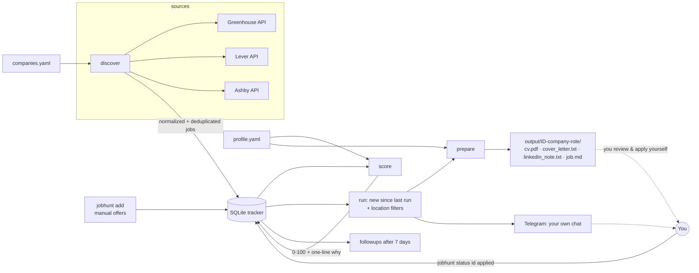

# job-hunt-copilot

[](https://github.com/carloslopezparga/job-hunt-copilot/actions/workflows/tests.yml)


A **human-in-the-loop** internship search assistant for an industrial engineering student
(ETSII-UPM, Madrid, EU citizen) looking for remote internships now and summer/off-cycle 2027
internships in **AI/tech, quant/trading, investment banking, consulting and fintech**.
Location priority: **Madrid → rest of Spain / remote from Spain or the EU → EU cities (no visa)
→ the rest of the world only where a visa is not a blocker**. Applications are prepared in
**English** (default) and **Spanish**.

It finds postings on public job boards, scores them against your profile, and prepares a
tailored **CV (PDF)**, a **150–200 word cover letter** and a **LinkedIn note (≤ 300 chars)**
for each good match. It tracks your pipeline, reminds you to follow up after 7 days, and can
be driven entirely from **Telegram** (`jobhunt bot`): commands, one message per offer with
buttons, and a built-in daily search.

> [!IMPORTANT]
> **The copilot never applies for you.** It does not submit forms, send emails or messages to
> employers, or automate LinkedIn in any way (no scraping, no clicks, no bots). It only reads
> **public, documented job-board APIs**, writes files to your disk and (optionally) messages
> **your own** Telegram chat. **You** review every document, decide whether to apply, and send
> it yourself.
>
> **It never invents or embellishes anything about you.** Every sentence in your CV, letters
> and messages is assembled from facts you wrote in `profile.yaml`. If your profile is too
> thin for a 150-word letter, you get a warning, not filler. An optional LLM can rephrase
> text, but a fact guard throws away any output that adds numbers, names or links.

---

## How it works



| Module | What it does |
| --- | --- |
| `profile.yaml` | Your single source of truth: education, experience, projects, languages (real CEFR level + certificate only if you hold it), skills, sector motivations, role/sector/location/date preferences and work authorization. Git-ignored. |
| `src/jobhunt/sources/` | Connectors for the public **Greenhouse**, **Lever** and **Ashby** job-board APIs behind one `JobSource` interface; `check.py` verifies boards before you rely on them. |
| `src/jobhunt/location.py` | Splits multi-location strings, recognises cities/countries/regions (EN/ES), remote/hybrid markers and whether a place needs a visa you lack; ranks each job into location tiers. |
| `src/jobhunt/scoring.py` | Scores each job 0–100 with configurable weights and a one-line explanation; location levels; hard caps (availability, contract, language); filters duplicates; re-scores automatically when the profile or the rules change. |
| `src/jobhunt/languages.py` | Detects language requirements in postings ("Italian Fluent", "Portuguese speaking", "French Market") and compares them with your profile. |
| `src/jobhunt/generator/` | Tailors your profile to the job (ranks *your* bullets/projects/skills), renders Jinja2 templates (EN/ES) and a reportlab PDF CV. Optional LLM polishing; works fully without one. |
| `src/jobhunt/tracker.py` | SQLite pipeline: `new → prepared → applied → follow_up → interview / rejected` (or `discarded`), full history, 7-day follow-up reminders, CSV export. |
| `src/jobhunt/bot.py`, `notify.py` | The Telegram bot (long polling, commands, buttons, daily search) and the notification client (your own bot and chat; credentials only from environment variables). |
| `src/jobhunt/cli.py` | Typer CLI: `init`, `discover`, `check-boards`, `add`, `score`, `locations`, `prepare`, `run`, `bot`, `status`, `followups`, `export`. |

## Installation

Requires **Python 3.12+**.

```bash
git clone https://github.com/carloslopezparga/job-hunt-copilot.git
cd job-hunt-copilot
python3.12 -m venv .venv && source .venv/bin/activate     # Windows: py -3.12 -m venv .venv; .venv\Scripts\Activate.ps1
pip install -e ".[dev]"          # add ,llm for optional LLM polishing: ".[dev,llm]"
```

## Try it offline in 30 seconds

The repo ships realistic API fixtures for three **fictional** companies and a **fictional**
example profile, so you can see the whole pipeline without network access or personal data:

```bash
export JOBHUNT_PROFILE=profile.example.yaml
export JOBHUNT_COMPANIES=tests/fixtures/companies.sample.yaml
export JOBHUNT_TODAY=2026-10-07          # pin "today" so the fixtures' dates make sense

jobhunt run --fixtures tests/fixtures --prepare --export shortlist.md
```

## Usage

### 1. Create your profile

```bash
jobhunt init            # copies profile.template.yaml -> profile.yaml (git-ignored)
```

Fill in every field marked `TODO`. The template explains each one. A few rules:

- **Write only what is true** and you can defend in an interview. Numbers only if you measured them.
- **Languages**: `level` is your real CEFR level; `certificate` only if you actually hold it
  (e.g. `Cambridge C1 Advanced (2022)`). Leave it empty otherwise.
- **Bilingual text**: any free-text field can be `"text"` or `{en: "...", es: "..."}`. Spanish
  letters never mix languages: untranslated sentences are left out (and reported).
- **Work authorization**: `personal.work_authorization: ["EU"]` means EU + EEA + Switzerland.
  Add `UK`, `US`… only if you really can work there without sponsorship.
- `jobhunt prepare` / `jobhunt run --prepare` **refuse to generate anything while any `TODO`
  remains**, so a half-filled template can never end up in front of a recruiter.

### 2. Discover offers and keep the company list healthy

```bash
jobhunt discover                       # all boards in companies.yaml
jobhunt discover -c Stripe -c Monzo    # just a few
jobhunt check-boards                   # 404s, empty boards, postings in Spain / EU per board
```

`companies.yaml` lists the employers that are read on every run (ATS, board slug, sector).
`companies.yaml` currently holds **102 boards**, every one verified against the live APIs
(startups and scale-ups based in Madrid/Barcelona, fintech, quant/trading, consulting, AI).
`companies.candidates.yaml` is the staging area for new employers: put the public board URL
in `notes`, verify the entry against the live API and append only the ones that work and have
postings an EU citizen can take without a visa:

```bash
jobhunt check-boards --file companies.candidates.yaml --promote companies.yaml
jobhunt check-boards --file companies.candidates.yaml --min-eu-jobs 3   # stricter
```

Investment banks and MBB consultancies recruit through Workday/Oracle/in-house portals with
no public API (Madrid off-cycle programmes at Citi, BofA, Barclays, Goldman, Nomura, Alantra,
Arcano…). Track those offers manually (paste the description into a file):

```bash
jobhunt add --company "Example Bank" --title "IBD Off-Cycle Analyst 2027" \
  --url "https://careers.example.com/123" --sector investment_banking \
  --location "Madrid, Spain" --workplace onsite --description-file desc.txt
```

### 3. Score

```bash
jobhunt score                                 # scores new jobs, lists the best ones with an explanation
jobhunt score --no-visa --location Madrid     # filters: --location TEXT, --no-visa, --remote-only, --limit N
jobhunt score --location "Remote - EU" --remote-only --limit 10
jobhunt score --rescore                       # force; done automatically when profile.yaml changes
jobhunt locations                             # how every location string in your tracker is classified
```

Scores are stored in the tracker together with a fingerprint of `profile.yaml` and of the
scoring rules: when either changes, the next `score`/`run`/bot search re-scores every job.
This also covers a database created by an older version (no fingerprint stored yet): its old
scores are recomputed once, automatically — no `--rescore` needed.

| Component | Default weight | How it is judged |
| --- | ---: | --- |
| `role` | 20 | Your `preferences.roles` in the title (1.0) or only in the description (0.4). Matching is by word root, so "Software Engineering Intern" matches `software engineer` and "Data Science" matches `data scientist` |
| `contract` | 20 | Internship detected from the ATS field or title (intern, off-cycle, summer analyst, prácticas, werkstudent…) |
| `location` | 20 | Location level, see below |
| `skills` | 15 | Your skills/tags found in the posting (5 matches = full marks) |
| `sector` | 10 | Company sector (from `companies.yaml`) is in your `preferences.sectors` |
| `dates` | 10 | "Summer 2027", "June 2027", "off-cycle 2027", "ASAP" (EN/ES)… matched against your availability windows |
| `remote` | 5 | Remote jobs fit everything; on-site jobs only fit availability windows without `remote_only` |

**Location levels.** `preferences.locations` has three lists (`preferred`, `acceptable`,
`avoid`). Entries can be cities (`Madrid`), countries (`Spain`, `España`), regions (`EU`,
`Europe`, `EMEA`), `Remote`, or a remote/hybrid place (`Remote - Spain`, `Remote - EU`,
`Hybrid - Madrid`). Job locations such as `Madrid; Remote - EU`, `Spain/España`,
`New York, NY | Barcelona, Spain` or `Madrid, London` are split, and **a job is ranked by the
best place it offers**. The priority is strong — a perfect Amsterdam offer cannot beat a
decent Madrid one:

| Level | Example (default profile) | Location component | Final-score multiplier |
| --- | --- | ---: | ---: |
| 1. `home` (your `preferred` city) | Madrid, Hybrid - Madrid | 1.0 | × 1.00 |
| 2. `country` (rest of its country, on site) | Barcelona, Valencia | 0.8 | × 0.92 |
| 3. `remote` (remote from there or the EU) | Remote - Spain, Remote - EU | 0.65 | × 0.88 |
| 4. `abroad` (EU/EEA/CH on site, no visa) | Amsterdam, Paris, Zurich | 0.45 | × 0.80 |
| 5. `other` (anywhere else you may work) | places added to `work_authorization` | 0.2 | × 0.55 |
| unknown / avoided | no usable location / anything in `avoid` | 0.4 / 0.1 | × 0.80 / × 0.50 |
| **visa** | every listed place needs a permit you lack (London, New York, Remote - US…) | 0.0 | **capped at 30** |

A posting that lists **more than 5 places** is not "Madrid" just because Madrid is one of
them: it is demoted to the next level and the explanation says so.

**Hard requirements.** Some things are not a matter of degree. An offer that fails any of
these can never score above **40**, so it never reaches the shortlist, and the explanation
says why (`max 40: …`):

- **Availability.** On-site (or unspecified-workplace) work that starts while you can only
  work remotely — i.e. only inside an availability window with `remote_only: true`, like the
  academic year — is capped. The same internship in summer 2027, or remote, is not.
- **Contract.** If your profile wants an `internship`: full-time, part-time and contract
  roles, "new grad"/"graduate"/"junior" titles, postings asking 2+ years of experience, and
  postings with no sign of an internship at all are capped.
- **Language.** If the posting *requires* a language your profile does not cover at B2 or
  better ("Italian Fluent", "Portuguese speaking", "French Market", "fluent in German and
  English", "dominio del italiano"…), it is capped. "… is a plus", "nice to have" and
  "se valora" are not requirements. A profile language still marked `TODO` is not held against
  the offer.

Titles containing an excluded keyword (`senior`, `staff`, `lead`…) or a past season
("Summer 2026") are capped at 15. Weights live in `profile.yaml → scoring.weights`.
Duplicates (same company + normalized title + city, e.g. a re-posted job) are dropped.

> If your `profile.yaml` was created from an older template it still has `location: 5` in
> `scoring.weights`; raise it to `20` (or delete the `weights` block to use the defaults).
> The level multiplier and the caps apply either way.

Example explanation:

```
91 · internship ✓ · role 'strategy' ✓ · fintech ✓ · junio 2027 fits 'Summer / off-cycle internship 2027'
   · on-site OK · skills: SQL, Excel · Madrid, Spain (preferred)
40 · max 40: on-site but starts in 'Remote internship during the academic year' (remote only until 2027-05-31)
   · internship ✓ · role 'software engineer' ✓ · ai_tech ✓ · february 2027 fits 'Remote internship…' · Madrid, Spain (preferred)
```

### 4. Prepare material (and review it!)

```bash
jobhunt prepare 12 15          # specific jobs
jobhunt prepare --top 5        # the 5 best "new" jobs above scoring.min_score_to_prepare
jobhunt prepare 12 --lang es   # force Spanish (default: Spanish postings -> es, else en)
```

Each job gets a folder like `output/0012-company-role/`:

| File | Content |
| --- | --- |
| `cv_en.pdf` | One-page CV: your relevant bullets first within each role, most relevant projects, job keywords in **bold**, matching skills listed first |
| `cover_letter_en.txt` | 150–200 words built from your degree, best-matching experience and project, skills, languages, sector motivation and availability window |
| `linkedin_note_en.txt` | ≤ 300-character connection note with a `[Name]` placeholder for you to fill in |
| `job.md` | The posting, its score, the link to apply **manually**, and a pre-send checklist |
| `warnings.txt` | Missing translations, length issues, rejected LLM edits… (only if any) |

#### Optional LLM polishing

```bash
pip install -e ".[llm]"
export ANTHROPIC_API_KEY=...
jobhunt prepare 12 --llm anthropic     # model: claude-opus-5-5 (override with JOBHUNT_LLM_MODEL)
```

The LLM only *rephrases* the template output. Its result is discarded (and you are told why)
if it adds a number, name or URL that is not in your profile or the posting, breaks the
150–200 word / 300 character limits, or the call fails. The default `--llm none` mode is
complete on its own.

### 5. The daily routine: `jobhunt run`

```bash
jobhunt run                                   # discover + score + show NEW matches
jobhunt run --prepare                         # ...and generate CV/letter/note for each
jobhunt run --export shortlist.md             # ...and save the shortlist as markdown
jobhunt run --notify telegram --prepare       # ...and send them to your Telegram
```

`run` shows only offers **first seen since the previous run**, with score ≥
`scoring.min_score_to_prepare`, that pass `preferences.locations.run_filter` (by default: no
offers that need a visa you lack; tiers preferred/acceptable/other). Jobs that were already in
the tracker before your first `run` are never reported. The shortlist markdown has company,
title, location, score, reason, link and a description excerpt.

With `--prepare`, nothing is generated if `profile.yaml` still has `TODO` fields: you get a
warning and the rest of the run (listing, export, notifications) still happens.

### 6. Track your pipeline

```bash
jobhunt status                          # counts per state + table
jobhunt status 12                       # detail + history
jobhunt status 12 applied --note "via careers site"   # after YOU applied (Spanish: aplicado)
jobhunt followups                       # applications with a follow-up due (7 days later)
jobhunt status 12 follow-up             # after you sent a follow-up -> next reminder in 7 days
jobhunt status 12 interview             # or: rejected / discarded / entrevista / rechazado / descartado
jobhunt export output/applications.csv  # open in Excel / Google Sheets
```

Global options (or env vars): `--profile` (`JOBHUNT_PROFILE`), `--db` (`JOBHUNT_DB`),
`--companies` (`JOBHUNT_COMPANIES`), `--out` (`JOBHUNT_OUTPUT`).

## Telegram bot (the main interface)

`jobhunt bot` turns your own Telegram bot into the control panel of the copilot. It runs on
your PC, long-polls Telegram, answers **only your chat** (messages and button presses from
any other chat are ignored without a reply) and **searches by itself once a day**, so it does
not need the Windows Task Scheduler.

| Command | What it does |
| --- | --- |
| `/hoy` | New offers (first seen today or yesterday) that pass your filters, **one message per offer** |
| `/madrid` | Best offers located in Madrid (your `preferred` city) |
| `/espana` | Best offers anywhere in Spain, including remote-from-Spain ones |
| `/pendientes` | Applications with no answer yet, and follow-ups that are due (7 days after applying) |
| `/stats` | Tracker size, pipeline counts, offers passing the filters, last search, daily time |
| `/buscar` | Runs discover + score right now and reports the new matches |
| `/ayuda` | The list of commands |

"Pass your filters" means: score ≥ `scoring.min_score_to_prepare`, location accepted by
`preferences.locations.run_filter`, and not already discarded/applied. At most 10 offers are sent
per command (`--max-offers`). Under every offer there are four buttons:

| Button | What it does |
| --- | --- |
| **Abrir** | Opens the official posting |
| **Preparar** | Generates and sends you the tailored **CV (PDF)** and **cover letter** to review. If `profile.yaml` still has `TODO` fields it says so and generates **nothing** |
| **Descartar** | Marks the offer `discarded`; it disappears from all lists |
| **Aplicada** | Marks it `applied` and schedules the 7-day follow-up. **Only the status changes** |

The bot never applies, never emails employers and never touches LinkedIn: you apply yourself on
the company's site and then press *Aplicada*.

**Daily search.** Every day at `--daily-at HH:MM` (default `09:00`, env `JOBHUNT_BOT_DAILY_AT`,
`--no-daily` to turn it off) the bot runs discover + score and sends a summary plus the new
matches. If the PC was off at that time, it runs as soon as the bot starts. The first full
scoring of a large database takes a few minutes; the bot keeps answering meanwhile.

### Set it up

1. **Create the bot.** In Telegram open a chat with **@BotFather** (check the blue tick), send
   `/newbot`, choose a display name and a username ending in `bot`. BotFather replies with a
   **token** like `123456789:AA...`. Treat it like a password.
2. **Get your chat id.** Open a chat with your new bot and send it any message (e.g. `hola`).
   Then open `https://api.telegram.org/bot<TOKEN>/getUpdates` in a browser (replace `<TOKEN>`)
   and look for `"chat":{"id":123456789,...}`. That number is your **chat id**. (If the page
   shows `"result":[]`, send another message to the bot and reload.)
3. **Store both as environment variables** — never in the repository or in `profile.yaml`.
   On Windows, **one command** in PowerShell (current user; it takes effect in new windows,
   and `start_bot.ps1` reads it from your user settings anyway):
   ```powershell
   setx TELEGRAM_BOT_TOKEN "123456789:AA..."; setx TELEGRAM_CHAT_ID "123456789"
   ```
   (or *Start → "Edit environment variables for your account"* /
   *"Editar las variables de entorno de esta cuenta"* → **New…** for each variable).
   macOS/Linux: `export TELEGRAM_BOT_TOKEN=... TELEGRAM_CHAT_ID=...` in your shell profile.
4. **Run it.** From the repository folder:
   ```powershell
   powershell.exe -NoProfile -ExecutionPolicy Bypass -File .\scripts\start_bot.ps1
   ```
   (or `jobhunt bot` inside the activated virtual environment). You get a "job-hunt-copilot
   activo" message in Telegram; try `/ayuda`. Options: `-DailyAt 08:30`, `-NoDaily`.
   `start_bot.ps1` activates `.venv`, reads the variables, allows only one running copy,
   restarts the bot if it crashes (and gives up if it cannot even start), and logs to
   `logs\bot_<date>.log` (kept 30 days).

### Start it automatically when you turn on the PC

Register a task that runs `start_bot.ps1` hidden every time you log in (run once, in
PowerShell, as your user; adjust the path):

```powershell
$repo = "C:\path\to\job-hunt-copilot"
$action = New-ScheduledTaskAction -Execute "powershell.exe" -WorkingDirectory $repo `
  -Argument "-NoProfile -WindowStyle Hidden -ExecutionPolicy Bypass -File `"$repo\scripts\start_bot.ps1`""
$trigger = New-ScheduledTaskTrigger -AtLogOn -User $env:USERNAME
$settings = New-ScheduledTaskSettingsSet -AllowStartIfOnBatteries -DontStopIfGoingOnBatteries `
  -StartWhenAvailable -ExecutionTimeLimit ([TimeSpan]::Zero)   # zero = never stopped after 72 h
Register-ScheduledTask -TaskName "job-hunt-copilot bot" -Action $action -Trigger $trigger -Settings $settings
```

Start it now without rebooting: `Start-ScheduledTask "job-hunt-copilot bot"`. To stop it:
`Stop-ScheduledTask "job-hunt-copilot bot"` (and `Unregister-ScheduledTask "job-hunt-copilot bot"`
to remove it). Without administrator rights you can instead press `Win+R`, type `shell:startup`
and put there a shortcut to `powershell.exe -NoProfile -WindowStyle Hidden -ExecutionPolicy
Bypass -File "C:\path\to\job-hunt-copilot\scripts\start_bot.ps1"`.

The bot lives while you are logged in on that PC: if the PC is off, messages you send are
answered when it starts again (Telegram keeps them for up to 24 h).

Privacy note: *Preparar* uploads your CV and letter (personal data) to Telegram's servers, to
your private chat with your own bot.

### One-off notifications without the bot

`jobhunt run --notify telegram [--prepare]` (same two environment variables) still sends the
new matches of one `run` as plain messages, optionally with the CV and the letter attached.

## Alternative: daily `run` with the Windows Task Scheduler

If you prefer not to keep the bot running, this schedules the one-shot `jobhunt run`.

`scripts\run_daily.ps1` activates `.venv`, reads the Telegram variables from your user
environment, runs `jobhunt run --notify telegram --prepare` (plus a dated shortlist in
`output\shortlist_<date>.md`) and writes a log to `logs\run_<date>.log` (kept 30 days).

First, check it by hand from the repository folder:

```powershell
powershell.exe -NoProfile -ExecutionPolicy Bypass -File .\scripts\run_daily.ps1
Get-Content (Get-ChildItem .\logs\run_*.log | Sort-Object LastWriteTime | Select-Object -Last 1)
```

Then schedule it (Spanish Windows labels in parentheses):

1. Open **Task Scheduler** (*Programador de tareas*): Start → type `taskschd.msc`.
2. **Action → Create Task…** (*Acción → Crear tarea…*; not the "basic task" wizard, which
   hides the setting in step 6).
3. **General** tab (*General*): name `job-hunt-copilot daily`; select **Run only when user is
   logged on** (*Ejecutar solo cuando el usuario haya iniciado sesión*), so the task sees your
   user environment variables and files.
4. **Triggers** tab (*Desencadenadores*) → **New…** (*Nueva…*): **Daily** (*Diariamente*), e.g.
   at 08:30, recur every 1 day → OK.
5. **Actions** tab (*Acciones*) → **New…** (*Nueva…*): **Start a program** (*Iniciar un
   programa*)
   - Program/script (*Programa o script*): `powershell.exe`
   - Add arguments (*Agregar argumentos*):
     `-NoProfile -ExecutionPolicy Bypass -File "C:\path\to\job-hunt-copilot\scripts\run_daily.ps1"`
   - Start in (*Iniciar en*): `C:\path\to\job-hunt-copilot`
6. **Settings** tab (*Configuración*): tick **"Run task as soon as possible after a scheduled
   start is missed"** (*"Ejecutar la tarea lo antes posible si se pasó una hora de inicio
   programada"*), so a day when the PC was off or asleep at 08:30 runs as soon as you log in.
   Optionally tick "If the task fails, restart every 10 minutes, up to 3 times".
7. **Conditions** tab (*Condiciones*): on a laptop, untick "Start the task only if the computer
   is on AC power" if you want it to run on battery.
8. OK, then right-click the task → **Run** (*Ejecutar*) to test it, and check **Last Run Result**
   (*Resultado de la última ejecución*: `0x0` = success) and the newest file in `logs\`.

Equivalent PowerShell (run once, as your user):

```powershell
$repo = "C:\path\to\job-hunt-copilot"
$action = New-ScheduledTaskAction -Execute "powershell.exe" -WorkingDirectory $repo `
  -Argument "-NoProfile -ExecutionPolicy Bypass -File `"$repo\scripts\run_daily.ps1`""
$trigger = New-ScheduledTaskTrigger -Daily -At 8:30
$settings = New-ScheduledTaskSettingsSet -StartWhenAvailable   # = "run as soon as possible after a missed start"
Register-ScheduledTask -TaskName "job-hunt-copilot daily" -Action $action -Trigger $trigger -Settings $settings
```

## Project layout

```
companies.yaml               employers read on every run (ATS + slug + sector)
companies.candidates.yaml    employers to verify with check-boards before adding
profile.template.yaml        commented template -> copy to profile.yaml (git-ignored)
profile.example.yaml         fictional filled-in example (used by tests and the demo)
scripts/run_daily.ps1        Windows Task Scheduler entry point (one-shot run)
scripts/start_bot.ps1        starts the Telegram bot and keeps it running (Windows)
src/jobhunt/
  profile.py                 load/validate profile, TODO detection, EN/ES text, fingerprint
  models.py                  Company and normalized Job
  sources/                   base.py (interface, fetchers), greenhouse/lever/ashby, check.py
  location.py                place parsing, visa checks, location tiers and levels
  languages.py               language requirements in postings vs. your profile
  scoring.py                 0-100 score, explanation, hard caps, date windows, dedup
  pipeline.py                discover/score/prepare steps, re-scoring, location filters
  bot.py                     Telegram bot: commands, buttons, daily search
  tracker.py                 SQLite states, history, follow-ups, run markers, CSV
  generator/                 tailoring, letters (Jinja2), cv_pdf (reportlab), llm (optional)
  shortlist.py, notify.py    markdown shortlist, Telegram
  cli.py                     Typer commands
tests/                       pytest suite + JSON fixtures in tests/fixtures/
```

## Development

```bash
pytest                 # connectors (fixtures + local HTTP server), location, scoring, tracker, generator, run/Telegram bot (simulated Telegram client), scoring on real postings, CLI
ruff check src tests && ruff format --check src tests
```

CI (GitHub Actions) runs lint, the test suite on Python 3.12 and 3.13, and the offline
end-to-end demo.

## Limitations and next steps

- Location parsing uses a built-in list of cities, countries and regions; an unknown city is
  ranked `unknown` (not `visa`). Run `jobhunt locations` to see how your real data is
  classified and report/extend anything misread.
- Visa logic is country-level: it cannot know about special programmes or sponsorship offered
  in a posting. Read the posting before discarding something you really want.
- Heuristics (internship detection, date parsing, language detection) are keyword-based and
  will miss unusual phrasings. The score is a triage aid, not a verdict: read the postings.
- Skill names are printed as written in your profile (they are not translated).

## Ethics

This tool exists to save you time on the boring parts, not to mass-apply. Recruiters can tell
when applications are spammed, and many platforms (including LinkedIn) prohibit automation.
Apply selectively, tailor what the copilot drafts, and only send things that are true.
